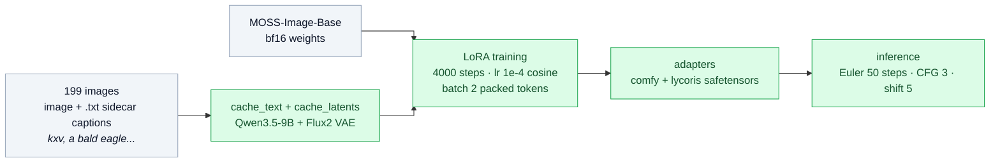

# kale-img


A style LoRA for **[MOSS-Image](https://huggingface.co/OpenMOSS-Team/MOSS-Image-Base)**
(5B DiT, Apache-2.0) that renders a soft-3D children's illustration look: one
subject, warm palette, plain white background. Trained with
[KohakuMossTrainer](https://github.com/KohakuBlueleaf/KohakuMossTrainer)
on a single consumer GPU.

Put **`kxv`** at the start of the prompt to call the style:

```
kxv, a red lighthouse on a small rocky island
```

🤗 **Model: [AmandineFlachs/kale-img-1-lora](https://huggingface.co/AmandineFlachs/kale-img-1-lora)**
— ComfyUI and LyCORIS safetensors, ~280 MB each.

### Why MOSS-Image

- Apache-2.0 weights: unambiguous commercial licensing (Sana's NVIDIA Open
  Model license restricts inference to NVIDIA hardware).
- Strong at illustration styles *and* text rendering — the LoRA keeps legible
  letters, useful for labeled kids' visuals.
- KohakuMossTrainer runs on Windows and Linux, sm86 through sm120.

### How it works



### Dataset format (bring your own)

The training set itself isn't included — it's a private image set. What matters
is the format, not the pixels:

```
dataset/images/
  a-bald-eagle.png
  a-bald-eagle.txt      # "kxv, a bald eagle gliding to the right with two ..."
```

One image + one `.txt` sidecar, natural-language caption, `kxv` leading.
`scripts/prepare_dataset.py` creates stubs or auto-captions with Florence-2.
For style LoRAs: caption *content*, let the trigger token carry the style.
Keep captions descriptive (subject, pose, palette, viewpoint) — the model
learns to map the rest of the sentence to `kxv`'s rendering.

### Train

```bash
git clone https://github.com/AmandineFlachs/kale-img && cd kale-img
# drop your images + captions in dataset/images/
bash scripts/train_lora.sh          # Linux
powershell -ExecutionPolicy Bypass -File scripts\train_lora.ps1   # Windows
```

The script installs KohakuMossTrainer, downloads weights (~26 GB bf16; the
~15 GB int8 ComfyUI layout works too — `WEIGHTS=`), writes a config under
`configs/user/`, caches text embeddings + latents, then trains. Checkpoints,
samples and exports land in `trainer/KohakuMossTrainer/runs/moss/<name>/`.
A 24 GB consumer GPU is enough for a LoRA.

Useful knobs (`--set` passes through to the trainer):

```bash
bash scripts/train_lora.sh --set LR=2e-4 --set STEPS=2000 --set MAX_TOKENS=16384
```

### Generate

```bash
python scripts/generate.py "kxv, a friendly robot waving hello" --out robot.png
```

Recommended sampling: flow-matching Euler, ~50 steps, CFG 3, shift 5.

### Layout

```
scripts/train_lora.sh     one-shot setup + train (Linux)
scripts/train_lora.ps1    same, Windows
scripts/generate.py       sample with the exported adapter
scripts/prepare_dataset.py  caption helper for new datasets (Florence-2)
```

Built in public. The model card lives on the
[HF repo](https://huggingface.co/AmandineFlachs/kale-img-1-lora).
